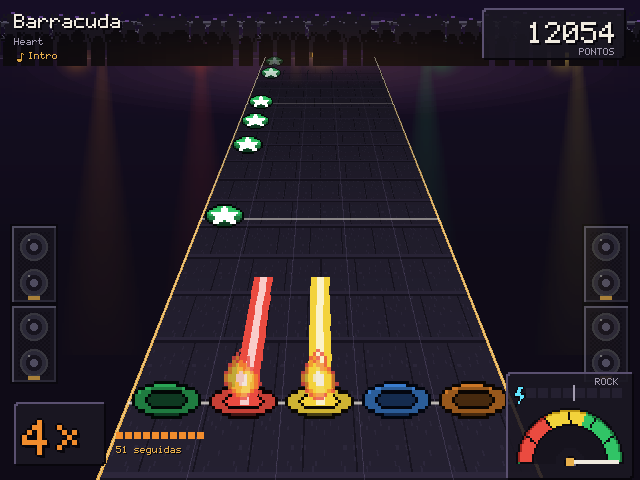
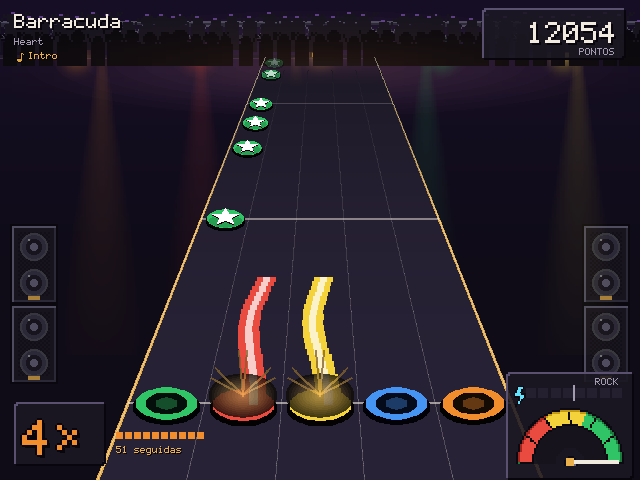
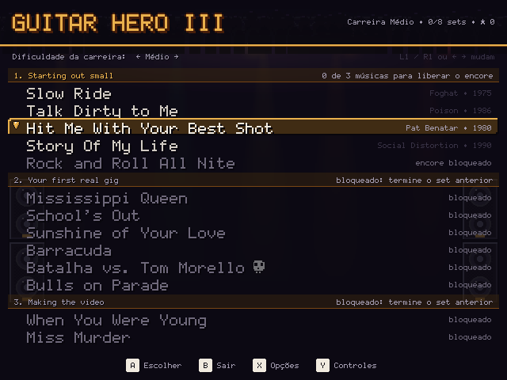
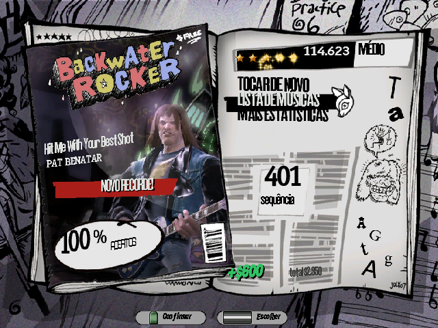

# Guitar Hero III nativo para R36S

Player de Guitar Hero III escrito em C para o R36S e outros portáteis RK3326 com PortMaster (ArkOS, dArkOS,
ROCKNIX, AmberELEC). Não é emulação: ele lê os arquivos da versão PC do jogo (músicas, partituras, carreira e
afinação) e desenha com SDL2 + GLES2, em visual próprio. As regras de acerto, a pontuação, as estrelas e a ordem
da carreira seguem as do jogo original.

| Pixel art | HD suave |
| --- | --- |
|  |  |
|  |  |

## O que tem

- Carreira liberada como no original (sets, batalhas, encores), por dificuldade, com recordes e estrelas salvos.
- Hammer-ons, sustains, star power, multiplicador e medidor de rock com as janelas de tempo do jogo.
- Controles iguais ao Guitar Hero III de PS2 por padrão (trastes em L2, L1, R1, R2 e B), configuráveis, com cinco perfis.
- Alavanca nos dois analógicos, que abaixa o tom das notas longas como no PS2.
- Calibração do atraso do som, dois temas visuais, menus em português, prévia das músicas.

## Instalação

Este repositório não traz nenhum arquivo do jogo: é preciso a pasta `DATA` da sua cópia do Guitar Hero III para PC.
O passo a passo, os controles e as opções estão em [port/README.md](port/README.md).

## Compilar

Num Linux (ou WSL) com SDL2, `aarch64-linux-gnu-gcc` e um sysroot aarch64 com SDL2 (glibc até 2.30):

```
make            # build/gh3 para o PC, com modos sem janela: --dump, --frames, --screens, --stretchtest
make port       # build/gh3.aarch64 e o zip do PortMaster em build/port/
```

O decodificador de MP3 é o [minimp3](https://github.com/lieff/minimp3) (CC0), em `third_party/`.
A pasta `tools/fixes/` guarda correções de outros ports usados no mesmo aparelho.

Guitar Hero é marca da Activision. Este projeto não é afiliado à Activision nem à RedOctane.
