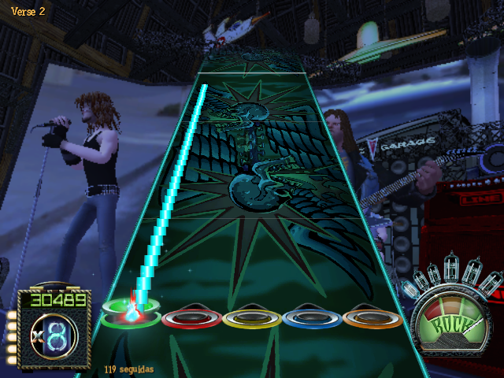
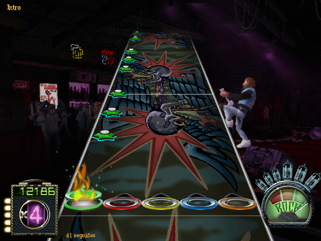
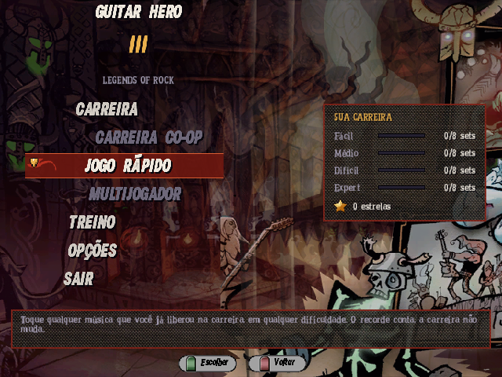
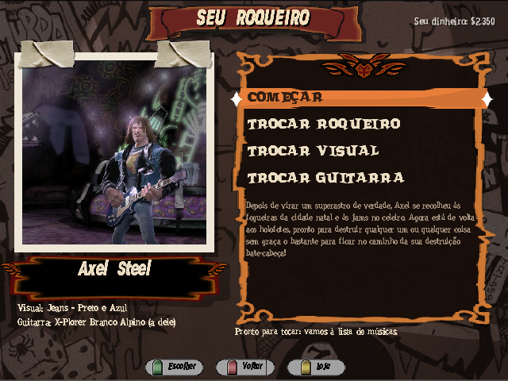
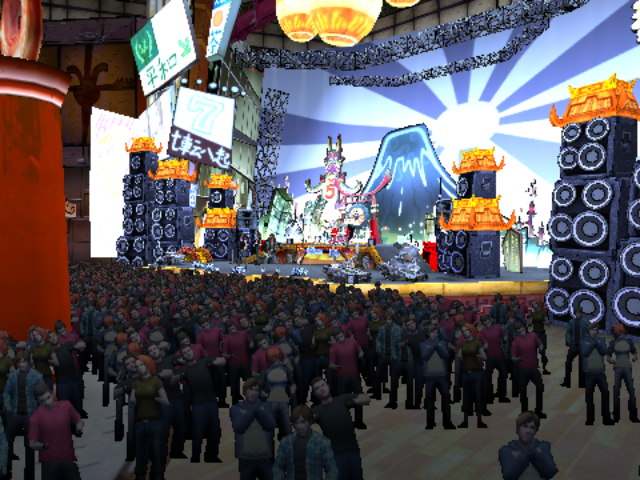

# Guitar Hero III nativo para R36S

[English](README.md) | Português

Player de Guitar Hero III escrito em C para o R36S e outros portáteis RK3326 com PortMaster (ArkOS, dArkOS,
ROCKNIX, AmberELEC). Não é emulação: ele lê os arquivos da versão PC do jogo (músicas, partituras, carreira, afinação,
arte, cenários e personagens) e desenha com SDL2 + GLES2 no visual do próprio jogo: os menus, as fontes e a pista do
GH3, e atrás dela os palcos, a banda e a plateia do jogo em 3D. As regras de acerto, a pontuação, as estrelas e a ordem
da carreira seguem as do jogo original.

| | |
| --- | --- |
|  |  |
|  |  |
|  |  |
|  | |

## O que tem

- Carreira liberada como no original (sets, batalhas, encores), por dificuldade, com recordes e estrelas salvos.
- Dinheiro da carreira pela tabela do jogo e a Loja: músicas e vídeos bônus, roqueiros secretos, guitarras e
  acabamentos com os preços originais; o coro do encore.
- "Seu roqueiro": o roqueiro, o visual e a guitarra que sobem ao palco, como no GH3.
- Batalhas contra Tom Morello, Slash e Lou com os ataques do jogo, o chefe na pista ao lado, o Dreno Mortal e os
  vídeos de fim de batalha.
- Hammer-ons, sustains, star power, multiplicador e medidor de rock com as janelas de tempo do jogo.
- Treino como no GH3: velocidades, trechos e, abaixo da velocidade cheia, a bateria do jogo no lugar da banda.
- Controles iguais ao Guitar Hero III de PS2 por padrão (trastes em L2, L1, R1, R2 e B), configuráveis, com cinco
  perfis, e o toque livre do controle comum do PS2.
- Alavanca nos dois analógicos, que abaixa o tom das notas longas como no PS2, com calibração.
- O palco do próprio jogo em 3D (os `.scn`/`.tex` de `ZONES/`): as câmeras do jogo cortando no ritmo da música, a
  banda tocando (com as poses de vitória e derrota e os ataques nas batalhas), a plateia que reage ao medidor de rock e
  o show de luzes da música. No R36S roda a 58,5 quadros por segundo.
- Os efeitos sonoros do jogo, as trapaças com os códigos de trastes, calibração do atraso do som, menus em português, inglês
  e espanhol (Opções > Vídeo > Idioma),
  prévia das músicas, os vídeos do jogo e os tutoriais narrados.

## Instalação

Este repositório não traz nenhum arquivo do jogo: é preciso a pasta `DATA` da sua cópia do Guitar Hero III para PC.
O passo a passo, os controles e as opções estão em [port/README.md](port/README.md) (em inglês: [port/README.en.md](port/README.en.md)).

## Compilar

Num Linux (ou WSL) com SDL2, `aarch64-linux-gnu-gcc` e um sysroot aarch64 com SDL2 (glibc até 2.30):

```
make            # build/gh3-3d (o jogo) e build/gh3 (o mesmo sem o 3D, para os testes) para o PC, com modos sem janela: --dump, --frames, --screens, --stretchtest, --r3dtest
make port       # build/gh3.aarch64 (com o 3D) e o zip do PortMaster em build/port/
```

O jogo do aparelho é compilado com `-DGH3_3D` e `src/r3d/` (leitor de cenas `.scn`, bancos `.tex`/DDS, câmeras e luzes do
`.qb` da zona, e o desenho em GLES2 cru dentro da janela do SDL_Renderer, antes da camada 2D). Sem `-DGH3_3D` nada de
`r3d/` entra: é o `build/gh3`, que os testes sem janela usam. `build/gh3-3d --r3dtest z_dive --out DIR` carrega uma zona numa janela escondida, salva
quadros e imprime malhas, texturas, triângulos, memória de vídeo e ms por quadro nas três resoluções do palco
(`R3D_NODXT=1` força o caminho do Mali: texturas decodificadas e comprimidas em ETC1).

O decodificador de MP3 é o [minimp3](https://github.com/lieff/minimp3) (CC0) e o de vídeo (MPEG-1 + MP2) é o
[pl_mpeg](https://github.com/phoboslab/pl_mpeg) (MIT), ambos em `third_party/`.
A pasta `tools/fixes/` guarda correções de outros ports usados no mesmo aparelho.

## Licença

O código deste projeto é livre, sob a [licença MIT](LICENSE). As bibliotecas em `third_party/` têm as suas próprias
licenças (minimp3: CC0; pl_mpeg: MIT). A licença vale só para o código: os arquivos do jogo, as músicas e os vídeos
continuam sendo da Activision e não fazem parte deste repositório.

Guitar Hero é marca da Activision. Este projeto não é afiliado à Activision nem à RedOctane.
